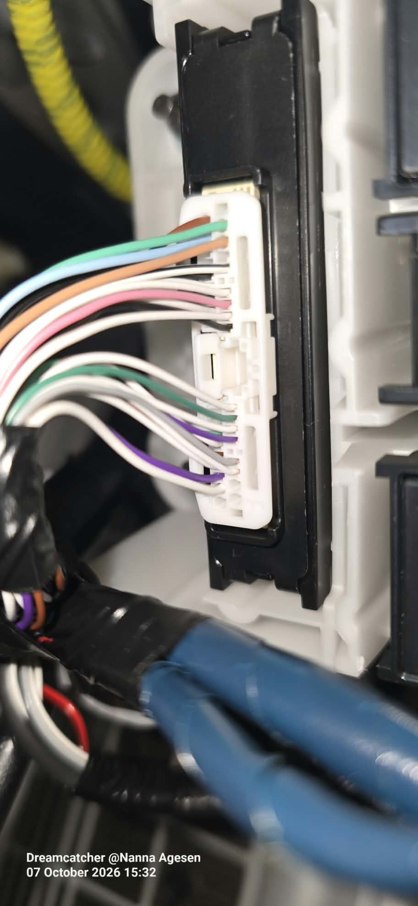
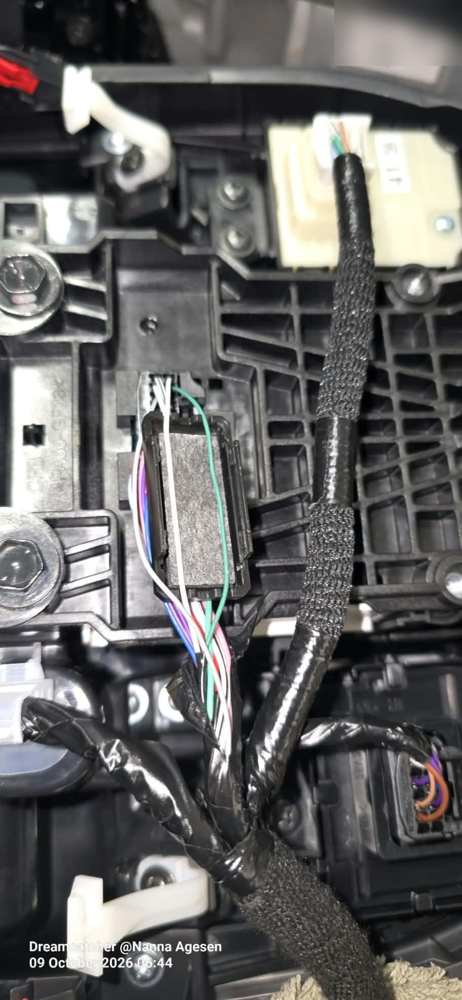
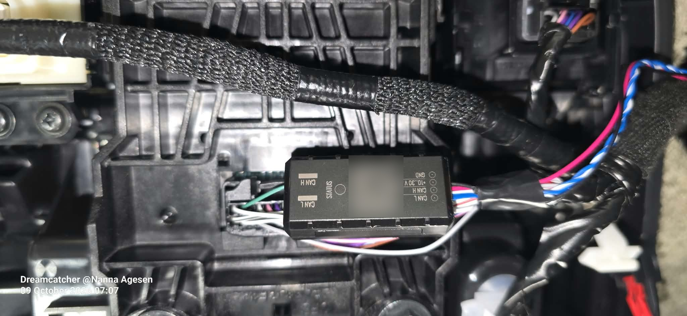

# Toyota bZ4X: Teltonika FMC650 + ALL-CAN300

Live CAN data from a Toyota bZ4X through a Teltonika **FMC650** tracker and an
**ALL-CAN300** CAN adapter, read with two **ECAN02** contactless clamps. The car's
wiring is never cut.

What it gives, in seconds rather than minutes:

- **HV battery state of charge** (%) — what the Toyota cloud reports late or not at
  all while the car charges
- range on the battery, dashboard odometer, wheel speed, accelerator pedal
- READY, ignition, key, gear P/R/N/D, handbrake, footbrake
- doors, trunk, hood, central locking, remote open/close
- charging cable connected, HV battery charging
- lights, AC, seat belts, ABS/ESP/airbag/EPS/tyre warning lamps

Fitted in October 2026 to a 2025-on bZ4X (the van version), FMC650 firmware
**03.01.01.Rev.15**. Everything below was measured on that car; where a value
comes from Teltonika's documentation instead, it says so.

> **Not documented here, on purpose:** where the tracker, the adapter and the
> antennas are mounted. A tracker is only worth having if a thief cannot find it.
> Choose your own places, and hide the LEDs.

## Contents

- [Parts](#parts)
- [The two CAN buses](#the-two-can-buses)
- [Wiring](#wiring)
- [Power and the tracker's ignition](#power-and-the-trackers-ignition)
- [Tracker configuration](#tracker-configuration)
- [What arrives, and where](#what-arrives-and-where)
- [Keeping the tracker awake through a charge](#keeping-the-tracker-awake-through-a-charge)
- [Sleep](#sleep)
- [Traps that cost hours](#traps-that-cost-hours)
- [Server side](#server-side)
- [What the car does not give](#what-the-car-does-not-give)

## Parts

| part | note |
|---|---|
| Teltonika FMC650 | with its power/IO cable and a data SIM |
| ALL-CAN300 "for FMx650 and FMB641" (`ALC300RUP101`) | comes with an **RJ45** lead to the tracker |
| 2 × ECAN02 | contactless clamps, one per bus — no splicing into a new car's CAN wiring |
| fuse holder, 3 A fuse, 0.5 mm² red and black wire | for the tracker's permanent +12 V |

**Program number 16145** — Teltonika's vehicle sheet for *TOYOTA BZ4X (Electric)
2025→*, with and without keyless system (sheet revision 11, valid from
2026-03-24). Ask Teltonika for the current sheet for your car. The adapter's
software date must be newer than the sheet's date, and an old adapter may refuse
a five-digit program number — read the label before it goes behind a panel.

**ALL-CAN300 only.** CAN-CONTROL is the adapter that also *commands* a car; this
build only reads, and through contactless clamps it cannot put anything on the
bus even in principle.

## The two CAN buses

| bus | connector | CAN-H | CAN-L | where |
|---|---|---|---|---|
| **CAN1** | white 34-pin | purple, **pin 30** | white, **pin 29** | behind the lower dashboard on the passenger side, in a bank of white connectors (Teltonika's sheet; checked in the car) |
| **CAN2** | black "F25" 24-pin | green, **pin 11** | white, **pin 12** | inside the centre console, under the rotary gear selector |

CAN1 carries driving, doors, locks, lights and gears. **CAN2 carries the HV
battery %** and the charging bits — without CAN2 there is no state of charge.

*CAN1 — the white 34-pin connector, checked against Teltonika's sheet before
fitting: the purple/white pair is exactly where the sheet draws it.*

*CAN2 — the black F25 connector under the gear selector, with the green
(CAN-H) / white (CAN-L) pair.*

*An ECAN02 on CAN2: the pair runs through the CAN H / CAN L slots, the four-wire
lead goes to the adapter.*

## Wiring

**ECAN02 → ALL-CAN300.** ECAN02 lead **blue (pin 1) to the adapter's CAN-L**,
**white/blue (pin 2) to CAN-H** (Teltonika's ECAN02 page). On the adapter's own
harness the **striped** wire of each pair is CAN-H, the plain one CAN-L:

| | adapter CAN-H | adapter CAN-L |
|---|---|---|
| CAN1 | brown/white striped | brown |
| CAN2 | green/white striped | green |

ECAN02 LED: off = no CAN under the clamp; on or flashing = data.

**ALL-CAN300 → FMC650.** RS232 through the RJ45 lead into the FMC650's **COM1**
socket (the FMC650 has two RS232 sockets; it must be the one configured as COM1).
Not miniUSB, not Input5/6 — the vehicle sheet's tracker side is generic; for the
FMx6 family Teltonika's *FMx6 CAN adapters* page wins.

**Power to the adapter:** +12 V and ground from the same feed as the tracker.

Teltonika's order of work: tracker connection, ground, +12 V, program number,
and only then CAN-L and CAN-H.

**ALL-CAN300 status LED:** a short red light at power-on = it boots; off
afterwards in READY = it understands nothing (no program number, wrong wiring, or
the bus asleep); solid = wrong program or wiring; **fast flashing = reading the
bus.**

**Programming by the SWITCH button** (a diagnostic, not normally needed — the
tracker sends the program number itself once COM1 is right): hold SWITCH until
the LED blinks, release; the LED counts — press right after the Nth blink for
each digit. For 16145: **1, 6, 1, 4, 5**. Ten blinks at the end = stored.

## Power and the tracker's ignition

The tracker needs a **permanent** +12 V with its own **3 A fuse** — live with the
car locked, or it cannot report a parked or charging car. Every joint soldered and
heat-shrunk, the leads bound in cloth tape.

The bZ4X's 12 V is not a combustion car's, and that decides how the tracker's
ignition must be set:

| state | 12 V measured |
|---|---|
| off, a few minutes after switch-off | 12.1–12.3 V |
| right after switch-off | 13.15 V |
| READY, 12 V battery not full | 13.8–14.35 V |
| **READY or driving, 12 V battery full** (after a long charge) | **12.4–12.8 V** |
| charging, first ~30 min | 14.0–14.2 V |
| charging, after that | 12.84–12.99 V, as low as 12.665 V |
| right after a charge ends | 12.51–12.64 V |

With a full 12 V battery the DC-DC holds it at float **even while driving**, so
"ignition = voltage above a threshold" alone drops out mid-drive.

**Ignition source, parameter 101 = 48** = Power Voltage (32) + Movement (16); the
sources are OR'ed. **Low voltage level, 105 = 13700 mV** (13200 flickered on/off
at the 13.15 V right after switch-off), high level 104 = 30000.

Costs of 48: standing still in READY with a full 12 V battery reads ignition off
after the movement stop delay (60 s) until the car rolls; a bump to the parked
car wakes the tracker for about a minute.

**The clean alternative:** DIN1 on a fuse that is live only with the car on, and
101 = 33 (DIN1 + Power Voltage, keeping the voltage path for charging, when
ACC is off). It needs the right fuse found and one more wire. Count first how
often the gap actually happens before deciding it is worth it.

## Tracker configuration

Settings as read back from the device. **[config/](config/)** has them as a
table and as ready-to-send `setparam` commands.

**Before anything else:**

1. **Firmware 03.00.16.Rev.01 or newer** (the P4 state flags need it).
2. **Data protocol Codec 8 Extended.** Plain Codec 8 has one-byte IO ids, and
   the CAN values are above 255.
3. **COM1 mode LVCAN, baud rate "Default"** — see the first trap below.
4. **Program number 16145** (Configurator → LVCAN, or SMS/GPRS
   `lvcansetprog 16145`).
5. **Status → CAN Adapter** (or `lvcangetinfo`) shows whether the adapter is
   detected and which program it runs. Look there first if nothing arrives.
6. **Enable the LVCAN I/O elements.** 61 of 73 were at *None* out of the box, and
   a disabled element is never sent. First pass: all at Low, trim later.
7. **Enable the P4 state flags** (Security / Control / Indicator P4) — separate I/O
   elements, off by default.

**Data acquisition** (Home, Roaming and Unknown identical):

| | Min Period | Saved records | Send Period | why |
|---|---|---|---|---|
| On Stop | 31 s | 1 | 125 s | 31 > Open Link Timeout (30) and 125 − 30 > 90: both are deep-sleep conditions |
| Moving | 5 s | 1 | 10 s | lively in READY; ~12 records a minute while charging instead of 60 at 1 s |

Moving also: min distance 100 m, min angle 10°, min speed delta 10.
**Movement source 100 = 0 (Ignition)**, start delay 1 s, stop delay 60 s.
**Open Link Timeout 1000 = 30 s.**

Movement source = CAN speed (100 = 3) was tried for a day: it keeps the record
count down during a charge, but a car standing in READY then counts as *On Stop*
and reports every 31–125 s — the app felt dead at a standstill. Ignition with a
5 s moving period was the better trade.

**Event priorities.** **HV battery level** (45630/45631) and **Security P4**
(46030/46031) at **High + On Change**: each change makes its own record and is
sent at once — lock, READY, cable, charging, gear and each % while charging arrive
in seconds instead of waiting for the send period. Cost: about 3 extra small sends
a minute while driving, one per ~5 min while charging, none parked. Everything else
Low + Monitoring.

**Doors stay Low + Monitoring** (45170/45171). With High + On Change the door
contact's bounce — open/closed every ~250 ms while a door shuts — became a record
per bounce, and at a standstill the last one sent could be "open".

**Switched off** (they ride in every record and say nothing): accelerometer axes
X/Y/Z (50220/50230/50240 — Traccar read AVL 236 as a false `alarm=general` in
94 % of records), IMSI, ICCID, DO3/DO4, network type, LVCAN program number,
module id, the legacy security/control flags (the P4 ones carry the same),
agricultural flags, CNG, engine oil.

**No internal battery % on this firmware:** a Configurator template shows
"Battery Level %" on parameter 53040, but the tracker answers that it does not
exist. AVL 113 is *Service Distance* on the FMx6 family (it is battery level on
the FMB family) — do not enable it as one. What exists is battery voltage
(AVL 67) and current (AVL 68).

## What arrives, and where

What the FMC650 really sends is **not** the generic CAN AVL list (824 SoC, 822
range …) and the P4 flags are not on by default. Seen on this car:

| AVL id | what | unit / note |
|---|---|---|
| **142** | HV battery level ("Battery Level Percent") | %, CAN2 — matched the Toyota app on the first reading |
| **526** | range on battery | **metres** |
| **36** | total mileage (dashboard) | **metres** |
| **30** | vehicle speed | km/h |
| **31** | accelerator pedal | % |
| **143** | door status | bitmask, below |
| **12710** | Security State Flags P4 | 8 bytes, below |
| **12711** | Control State Flags P4 | lights, AC, belts |
| **12712** | Indicator State Flags P4 | warning lamps |
| 47 / 38 | Security / Control State Flags, legacy layout | the same information; off here |
| 200 | sleep mode | 0 none, 1 **deep**, 2 GPS, 3 online deep (not parameter 102's order) |

Door status (143): `0x0100` front left, `0x0200` front right, `0x0400` rear left,
`0x0800` rear right, `0x1000` hood, `0x2000` trunk.

Bits **confirmed on the car**:

| table | bit | meaning |
|---|---|---|
| Security P4 | 8 / 9 / 13 | ignition / key / READY |
| Security P4 | 18 / 19 | handbrake / footbrake |
| Security P4 | 22–27 | doors FL, FR, RL, RR, trunk, hood |
| Security P4 | **28** | **charging cable connected** (stays set while the buses sleep) |
| Security P4 | **29** | **HV battery charging** — the main phase only: it went off at 98 % while the charger still delivered 8 kW, and came back at 100 % |
| Security P4 | 30 | electric motor working |
| Security P4 | 32 | central locking (auto-lock at 22–24 km/h seen) |
| Security P4 | 41 / 42 / 43 / 44 | P / R / N / D |
| Control P4 | 0–4 | sidelights, dipped, full beam, rear fog, front fog |
| Control P4 | 8 | AC on |
| Control P4 | 12 | driver's belt |

The rest of the sheet's 46 flags follow Teltonika's P4 tables (*FMC650 CAN
adapters* for Security P4, *FMC130/FMB110 CAN adapters* for Control and
Indicator P4). Open: the "remote pressed 3×" bit (40 on one page, 48 on the
other).

**Not in a record while the ignition is off.** With the tracker's ignition off it
keeps sending positions but **leaves out every LVCAN value** — although the
adapter is still reading the bus. LVCAN parameter 45001, *Send data with 0 if
ignition is off*, sends **zeros** (SoC 0 %), so leave it off. Treat CAN values by
their age, not as current.

## Keeping the tracker awake through a charge

During a charge the 12 V falls below 13.7 V after about half an hour, the tracker
calls the ignition off, and the SoC stops arriving. Teltonika offers no CAN-based
ignition on the FMC650.

The fix used here: when the charger starts charging the car, the server sends the
tracker `setparam 105:12600` (low level 12.6 V) through Traccar's command API, and
`setparam 105:13700` when the charge ends. Two guards matter:

- **Put 13.7 V back promptly.** After a charge the 12 V settles at
  12.51–12.64 V, right on 12.6 V: the ignition flapped 50 times in 41 s. Restore at
  once when the ignition changes 4 times in a minute, not after a grace period.
- **A permanently lower threshold does not work:** a full 12 V battery rests at
  12.7–12.8 V and the tracker would never sleep.

## Sleep

**Deep sleep** (io200 = 1) came about 6 minutes after switch-off and locking. It
needs:

- On Stop Min Period > Open Link Timeout
- On Stop Send Period − Open Link Timeout > 90 s
- **nothing on the USB port** — a connected laptop keeps it awake on its own

In deep sleep it still wakes every Send Period + Open Link Timeout (about every
2.5–3 minutes with these settings), makes a record and is online for about a
minute. Expect a current spike every few minutes, not a flat line; the average is
the figure that matters for the 12 V battery. A longer On Stop Send Period means
fewer wakes, but lock state, position and queued commands arrive that much later
while parked.

**The FMC650 does not restart when its power is pulled** — the internal battery
keeps it running. Restart with the Configurator's Reboot, or the command
`cpureset`.

## Traps that cost hours

1. **COM1 baud rate.** With COM1 at **115200** (from a forum thread) the adapter
   was programmed and reading the car, LED flashing fast, ECAN02 lit — and the
   tracker never heard it: no CAN adapter on the status page, not one LVCAN value,
   whatever was restarted. **"Default"** (the top entry) fixed it at once: program
   number, odometer, range and doors within minutes.
2. **"Save to device" from an older saved file** puts old values back
   (ignition source, movement source, priorities). **Read the configuration from
   the device before editing**, and save a fresh copy after every change.
3. **Set the APN explicitly; do not leave AutoAPN on.** A wrong APN that some
   cells tolerate and others refuse gives a tracker that works in some places and
   is dead in others.
4. **The P4 flags and most LVCAN elements are off by default.** No value in the
   server's raw attributes usually means *disabled*, not *not supported*.
5. **The same IO number means different things on different peripherals.** An
   OBD dongle's io30–48 are not the CAN adapter's AVL 30–48.
6. **Units:** range and odometer arrive in **metres**.
7. **Commands:** the tracker handles one command at a time, and a long
   `getparam` list can come back truncated. Send a few parameters per command and
   wait for the matching reply (`New value …`), not an earlier one.

## Server side

The tracker reports to a [Traccar](https://www.traccar.org/) server (Teltonika
protocol, Codec 8 Extended). Into [openHAB](https://www.openhab.org/) it comes
through the [openHAB Traccar binding](https://github.com/Prinsessen/openhab-traccar-binding),
which decodes the ALL-CAN300 values into channels of their own (SoC, range,
odometer, READY, gear, doors, cable, charging, …), keeps the newest record when
records arrive out of order, and can set speed and pedal to 0 when the car is in
P with the ignition off. Its
[CAN adapter example](https://github.com/Prinsessen/openhab-traccar-binding/blob/main/docs/can-adapter-example.md)
has the thing, items and rules (charge target, plugged-in-not-charging, night
check, warning lamps). The charge wake above is a rule of its own on the server
that sends the two `setparam` commands; it is not in the binding.

Worth doing whatever the server: keep the Toyota cloud's state of charge as a
fallback and a cross-check, and pick per signal the freshest source — CAN while
the tracker is awake, the cloud while it sleeps.

## What the car does not give

Not on this car's CAN through the ALL-CAN300: battery temperature, charging power
or current, cell voltages, individual tyre pressures (only a "low" flag), climate
state, window positions. The VIN is in the list but has not been seen. Those stay
with the manufacturer's cloud.

## Disclaimer

This is one owner's installation, written down. Working behind a car's trim
panels, near airbags and wiring looms, is at your own risk; check what it means for
your warranty. Nothing here is endorsed by Toyota or Teltonika.

## License

[MIT](LICENSE) © 2026 Nanna Agesen
